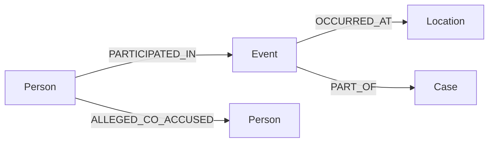

# Paris "Rugby Camp" Human Trafficking Case: Graph Database Study

A graph data model of the 2016-2017 Paris Rugby Camp human trafficking case, built in **Neo4j AuraDB**. The project shows how a trafficking case can be represented as a network of people, events and places, and how graph queries can surface its structure.

> **Case summary:** Three travel agents allegedly trafficked 25 Indian youths (aged 13 to 18) from Delhi, Punjab and Haryana to France under the pretext of a rugby training camp.

---

## Objectives

- Model a real-world trafficking case as a property graph (nodes and relationships).
- Prepare clean, import-ready CSV datasets for Neo4j AuraDB.
- Demonstrate Cypher queries for case structure, actor roles and geography.
- Keep the data ethical: anonymized, source-traceable and free of personal identifiers.

## Tech Stack

| Tool | Purpose |
|---|---|
| Neo4j AuraDB | Cloud graph database |
| Cypher | Querying the graph |
| CSV | Source data format |
| Neo4j Data Importer / `LOAD CSV` | Loading data |
| Neo4j Browser / Bloom | Visualization |

## Repository Structure

```
paris-rugby-camp-trafficking-graph/
├── README.md
├── data/
│   ├── persons.csv
│   ├── cases.csv
│   ├── locations.csv
│   ├── events.csv
│   ├── event_location.csv
│   ├── person_event.csv
│   └── person_person.csv
├── cypher/
│   └── queries.cypher
└── images/
    └── graph-screenshot.png
```

## Graph Model



### Nodes

| Label | Count | Key properties |
|---|---|---|
| `Person` | 28 | `personId`, `alias`, `role`, `ageRange`, `nationality`, `legalStatus`, `caseId` |
| `Case` | 1 | `caseId`, `title`, `type`, `startYear`, `endYear`, `victimCount`, `destinationCountry`, `pretext` |
| `Event` | 2 | `eventId`, `type`, `period`, `description`, `caseId` |
| `Location` | 4 | `locationId`, `name`, `type`, `country`, `lat`, `lon` |

`Person` nodes are 3 alleged travel agents (`A01` to `A03`) and 25 youths (`V01` to `V25`).

### Relationships

| Relationship | Pattern | Properties |
|---|---|---|
| `PARTICIPATED_IN` | `(Person)-[]->(Event)` | `roleInEvent` |
| `OCCURRED_AT` | `(Event)-[]->(Location)` | `roleAtLocation` |
| `PART_OF` | `(Event)-[]->(Case)` | none |
| `ALLEGED_CO_ACCUSED` | `(Person)-[]->(Person)` | `sourceNote` |

## Data Files

| File | Description |
|---|---|
| `persons.csv` | Anonymized individuals, using codes instead of names |
| `cases.csv` | Case-level metadata |
| `locations.csv` | Origin regions (Delhi, Punjab, Haryana) and destination (Paris) |
| `events.csv` | Recruitment and transport events |
| `person_event.csv` | Links people to events with their role |
| `event_location.csv` | Links events to locations |
| `person_person.csv` | Relationships between the alleged agents |

## Getting Started

### Option 1: Neo4j Data Importer (recommended)

1. Create a free instance at [Neo4j Aura](https://neo4j.com/cloud/platform/aura-graph-database/).
2. Open **Import** in the Aura console and upload all files from `data/`.
3. Map the nodes:
   - `persons.csv` → `Person` (ID: `personId`)
   - `cases.csv` → `Case` (ID: `caseId`)
   - `locations.csv` → `Location` (ID: `locationId`)
   - `events.csv` → `Event` (ID: `eventId`)
4. Map the relationships:
   - `person_event.csv` → `PARTICIPATED_IN`
   - `event_location.csv` → `OCCURRED_AT`
   - `events.csv` (via `caseId`) → `PART_OF`
   - `person_person.csv` → `ALLEGED_CO_ACCUSED`
5. Click **Run import**.

### Option 2: Cypher `LOAD CSV`

Create the constraints first:

```cypher
CREATE CONSTRAINT person_id IF NOT EXISTS FOR (p:Person) REQUIRE p.personId IS UNIQUE;
CREATE CONSTRAINT case_id IF NOT EXISTS FOR (c:Case) REQUIRE c.caseId IS UNIQUE;
CREATE CONSTRAINT loc_id IF NOT EXISTS FOR (l:Location) REQUIRE l.locationId IS UNIQUE;
CREATE CONSTRAINT event_id IF NOT EXISTS FOR (e:Event) REQUIRE e.eventId IS UNIQUE;
```

Load a node file using its raw GitHub URL:

```cypher
LOAD CSV WITH HEADERS FROM
'https://raw.githubusercontent.com/Mim22-shp/paris-rugby-camp-trafficking-graph/main/data/persons.csv' AS row
MERGE (p:Person {personId: row.personId})
SET p.alias = row.alias, p.role = row.role, p.ageRange = row.ageRange,
    p.nationality = row.nationality, p.legalStatus = row.legalStatus;
```

Load the remaining files the same way, nodes first and relationships second.

## Example Queries

**View the full network**
```cypher
MATCH (n)-[r]->(m) RETURN n, r, m;
```

**Origin regions of the recruitment event**
```cypher
MATCH (p:Person {role:'victim'})-[:PARTICIPATED_IN]->(e:Event {type:'recruitment'})-[:OCCURRED_AT]->(l:Location)
RETURN l.name AS region, count(DISTINCT p) AS youths
ORDER BY youths DESC;
```

**Who organized which events**
```cypher
MATCH (p:Person)-[r:PARTICIPATED_IN]->(e:Event)
WHERE r.roleInEvent = 'alleged_organizer'
RETURN p.alias, e.type, e.description;
```

**Route from origin to destination**
```cypher
MATCH (e:Event {type:'transport'})-[r:OCCURRED_AT]->(l:Location)
RETURN l.name, l.country, r.roleAtLocation;
```

**Most connected nodes**
```cypher
MATCH (n)-[r]-()
RETURN labels(n)[0] AS type, coalesce(n.alias, n.name, n.title) AS name, count(r) AS connections
ORDER BY connections DESC LIMIT 10;
```

## Visualization


```markdown

```

## Data Sources

The dataset is built from publicly reported information about the case. Add the sources behind each record in the `sourceNote` column of the CSVs and list them below.

- Source: _[court document, news report or published study]_

## Limitations

- The data uses only the case facts available at modelling time. Individual names, exact dates, each youth's home state, gender and exact age are left blank due to ethical reasons.
- The agents are described as **alleged**. Legal status fields should be updated to match any verdict reported in your sources.
- Coordinates for Delhi, Paris and the states of Punjab and Haryana are approximate centroids, not precise points.
- The model covers two events (recruitment and transport). It can be extended with arrival, detection, rescue, asylum or legal proceedings once sourced.

## Ethics and Responsible Use

This project deals with minors and a serious crime. To protect them:

- All individuals are represented by **codes**, with no real names, photographs, contact details or addresses.
- Only **public-source** information is used.
- The accused are described as **alleged** unless a conviction is documented.
- The dataset is for **education and research** only.

If you extend this project, keep victim identities anonymous.

## Possible Extensions

- Add organizations, phone numbers, financial transactions or travel documents.
- Add the full timeline (arrival in France, detection, legal proceedings).
- Use the Neo4j Graph Data Science library for centrality and community detection.
- Map the origin and destination locations in QGIS or Python (GeoPandas).
- Compare the network with other trafficking case studies.

## Author

**Mimansa Meshram**
Geospatial Data Analyst | GIS, Remote Sensing and Data Science
GitHub: [Mim22-shp](https://github.com/Mim22-shp)


